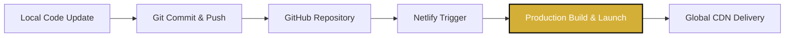

# 👑 Salon Colombia — Luxury Beauty Salon Web Application

[](https://saloncolombia.netlify.app/)
[](#)
[](#)
[](#)
[](#)
[](#)

Welcome to the official repository of **Salon Colombia Pvt Ltd** (owned by Samuditha), a state-of-the-art, premium single-page web application. Crafted with clean semantic HTML5, sophisticated CSS3 design tokens, and highly optimized vanilla ES6 JavaScript, this digital storefront brings the salon's luxurious physical experience to the web. 

Located in the heart of **Nugegoda, Sri Lanka**, Salon Colombia offers premium beauty treatments, professional hairdressing, custom nail arts, bridal dressing, and revitalizing skin therapies at affordable luxury standards.

---

## 🌟 Premium Application Features

### 1. 🎨 Elegant Gold & Charcoal Visual System
The application is styled with a high-end, carefully curated color palette featuring **Gilded Gold (`#d4af37`)** and **Velvet Charcoal (`#0a0a0a`)**. Designed for maximum visual impact, it leverages modern typography (Google Fonts *Playfair Display* & *Plus Jakarta Sans*), fluid interactive transitions, and subtle micro-animations that respond seamlessly to user input.

### 2. ⚡ Hybrid Power Outage Indicator (USP)
A unique value proposition designed specifically for the Sri Lankan municipal landscape: the app showcases a prominent, custom **Power Backup badge** reassuring clients that all salon operations, high-draw styling tools, and electronic bookings are fully supported by an active hybrid power generator system during public grid failures.

### 3. 🕒 Real-Time "Open Now" Status Engine
Powered by high-precision JavaScript, the app automatically tracks **Sri Lanka Standard Time (GMT+5:30)** to calculate if the salon is currently open (9:00 AM - 7:00 PM). It dynamically renders a glowing green **"Open Now"** badge or a sleek crimson **"Closed"** status banner across the website, eliminating customer scheduling uncertainty.

### 4. 🎛️ Fluid Category Filtering System
Clients can easily browse through the menu of premium services (Hair Care, Nails, Makeup, Skin Care) using an interactive, hardware-accelerated grid. Filters apply custom scales, opacity transitions, and active button states instantly without page reloads.

### 5. 📂 Persistent Client-Side Booking & Receipt Dashboard
An extensive booking portal is built directly into the client side:
- **Smart Datepicker Validation**: Prevents backdated appointments by dynamically configuring minimum available dates to the client's current calendar day. If the customer visits the site after daily booking hours have ended (6:00 PM onwards), the system automatically locks out today and advances the calendar minimum to tomorrow.
- **Same-Day Time Slot Validation**: Prevents booking past time slots on the current day. If a user selects today's date, all time slots that have already started or passed are blocked from submission, ensuring high-integrity bookings.
- **Emoji-Free WhatsApp Integration**: Employs clean, high-compatibility plain text for booking confirmation templates sent via the WhatsApp API, completely avoiding character set rendering issues (such as `?` or `` icons) across different device platforms and browser encodings.
- **Contextual Pre-Filling**: Booking forms auto-populate fields based on which service card or catalog element triggered the modal.
- **In-Browser Local Database (`LocalStorage`)**: Keeps track of scheduled visits persistently.
- **Dynamic Invoice Receipt**: Renders an interactive checkout invoice and appointment status dashboard directly on the page, with built-in styling for status badges.
- **Cancellation Handler**: Features secure confirmation prompts for cancellation requests.

### 6. 🗺️ Dark-Minimal OpenStreetMap & Leaflet.js Engine
Instead of standard heavy embedding, the website integrates the lightweight **Leaflet.js** mapping API coupled with custom golden coordinates pinpointing the salon on Mudalige's Avenue. Popups styled with dark typography and calling triggers are bound seamlessly to the interactive coordinate marker.

### 7. 🚀 Automated CI/CD Setup
Optimized build assets are fully configured to compile, compress, and deploy instantly on Netlify. Advanced HTTP headers (CSP, security flags) and compression routes are pre-defined in the `netlify.toml` file to guarantee top-tier performance.

---

## 🛠️ Technology Stack

| Component | Technology | Role in Architecture |
| :--- | :--- | :--- |
| **Structure** | Semantic HTML5 | Structured DOM, full accessibility (ARIA), and structured outline. |
| **Presentation** | Custom Vanilla CSS3 | Modular HSL color tokens, Flexbox & Grid layouts, keyframe animations. |
| **Application Logic** | Vanilla ES6 JavaScript | DOM event delegation, timing engines, validation, local caching. |
| **Geographic Mapping**| Leaflet.js + OpenStreetMap | Interactive, dark-mode styling location display with custom markers. |
| **SEO & Meta** | JSON-LD Structured Data | Technical SEO schema marking for Google Local Business & Rich Snippets. |
| **Hosting & CI/CD** | Netlify | Automatic Git integration, CDN deployment, advanced redirect rules. |

---

## 📁 Repository Architecture

```bash
Salon-Colombia/
├── index.html              # Single-page core document, meta headers, and JSON-LD schema
├── style.css               # Styling system, design system variables, layout engines, and animations
├── app.js                  # Main Javascript core: scheduling database, map integration, and timers
├── netlify.toml            # Server optimization config, custom security headers, and compression
├── robots.txt              # Crawl instructions for search engines
├── sitemap.xml             # XML sitemap for SEO discovery
├── site.webmanifest        # PWA-compatible application manifest
├── favicon.svg             # Modern vector brand favicon
├── apple-touch-icon.png    # High-resolution brand icon for Apple home screens
└── images/                 # Optimized premium photorealistic showcase images
    ├── salon_interior.png  # Panoramic view of the golden styling stations
    ├── hair_styling.png    # Close-up of professional blow-dry service
    ├── nail_art.png        # Intricate golden details on acrylic nails
    └── bridal_makeup.png   # Premium bridal dressing model showcase
```

---

## 🚀 Getting Started Locally

### Option A: Standard XAMPP / WAMP Installation (Recommended)
Because the application is configured for a standard Apache structure:
1. Copy or clone this directory into your XAMPP server root (typically `C:\xampp\htdocs\Salon-Colombia`).
2. Open the **XAMPP Control Panel** and click **Start** next to the **Apache** module.
3. Launch your browser and navigate to:
   ```url
   http://localhost/Salon-Colombia/index.html
   ```

### Option B: Lightweight Python Web Server
If you want to run the app quickly without a full database stack:
1. Open your terminal of choice (Command Prompt, PowerShell, or Git Bash) inside the project folder.
2. Spin up a local Python server:
   ```bash
   python -m http.server 8000
   ```
3. Open your browser and navigate to:
   ```url
   http://localhost:8000
   ```

---

## 🔍 Technical SEO & Google Integration
Salon Colombia has been optimized following strict SEO patterns to capture top rankings in Google Local Business search:
- **Structured Schema JSON-LD**: Embedded inside [index.html](file:///d:/xampp/htdocs/Salon-Colombia/index.html) is a complete schema configuration describing the `BeautySalon` type, coordinates, phone numbers, localized price range, and hours to Google bots.
- **Social Graph Optimization**: Active OpenGraph (`og:`) and Twitter Card elements showcase styling photographs and branding descriptions when the link is shared on social platforms.
- **Semantic HTML5**: Full layout segmentation (`<header>`, `<section>`, `<article>`, `<footer>`) ensures clear hierarchy and maximum accessibility compliance.

---

## 🌐 Production CI/CD Pipeline
Continuous Integration and Deployment are configured automatically via Netlify:



### Deployment Flow:
When you push any updates to the `main` branch of this repository, Netlify intercepts the webhook, parses the `netlify.toml` build configurations, optimizes resource delivery headers, and updates the live website at:
**[saloncolombia.netlify.app](https://saloncolombia.netlify.app/)**

---

## 📞 Business Information & Hours

| Operational Attribute | Value / Details |
| :--- | :--- |
| **Owner** | Samuditha |
| **Address** | 17A 2nd Floor, Mudaliyar's Avenue, Nugegoda, Sri Lanka |
| **Direct Hotline** | [074 009 9725](tel:0740099725) |
| **Official Email** | [saloncolombia82@gmail.com](mailto:saloncolombia82@gmail.com) |
| **Working Hours** | Monday - Sunday: 09:00 AM - 07:00 PM (Sri Lanka Time) |
| **Web Catalog** | [Roo.lk Shop Directory Listing](https://www.roo.lk/shop/Salon-colombia-124) |

---
*Developed with meticulous attention to detail and designed for high-conversion styling bookings in Nugegoda.*
